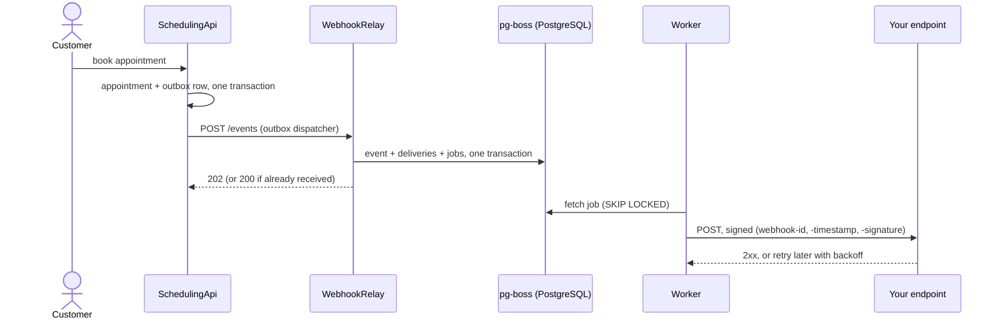

# WebhookRelay

[](https://github.com/EduardoCruz78/WebhookRelay/actions/workflows/ci.yml)


[](LICENSE)

Reliable event delivery service. It receives domain events (for example `appointment.created` from
[SchedulingApi](https://github.com/EduardoCruz78/SchedulingApi)), stores and queues them in one
transaction, and delivers them to subscribers (webhooks, e-mail, Telegram) **at least once**, with
exponential backoff and jitter, a dead-letter queue, idempotent ingestion and HMAC-signed webhooks.



## Delivery guarantees

- **At least once.** A delivery is retried until the destination answers `2xx` within 10 s, or
  until it is dead-lettered. The `webhook-id` header is the same on every retry: deduplicate on it.
- **Idempotent ingestion.** The same `(source, id)` posted twice is answered `200` and creates
  nothing, enforced by a unique constraint (`INSERT ... ON CONFLICT DO NOTHING`).
- **Retries.** Timeouts, network errors, `5xx`, `408` and `429` are retried with exponential backoff
  and full jitter (ceilings 30 s, 2 min, 8 min, 32 min, ~2 h, 6 h, 6 h). `Retry-After` is honoured.
- **Dead-letter queue.** Other `4xx`, redirects and blocked targets fail at once; after 8 attempts a
  delivery is `dead`. `GET /deliveries?status=dead` lists them and `POST /deliveries/{id}/replay`
  sends one again.
- **Order** is not guaranteed across events: compare `occurredAt`.

Details and the reasoning: [docs/delivery-guarantees.md](docs/delivery-guarantees.md).

## Verifying webhooks

Headers follow [Standard Webhooks](https://www.standardwebhooks.com), so any of its libraries works:

```ts
import { Webhook } from 'standardwebhooks';

const event = new Webhook(process.env.WEBHOOK_SECRET!).verify(rawBody, request.headers);
```

In C#:

```csharp
var key = Convert.FromBase64String(secret["whsec_".Length..]);
var expected = HMACSHA256.HashData(key, Encoding.UTF8.GetBytes($"{id}.{timestamp}.{body}"));
// accept if any "v1,<base64>" in webhook-signature matches (CryptographicOperations.FixedTimeEquals)
// and the timestamp is within 5 minutes
```

Full Node and .NET versions, tested in both repositories: [docs/webhook-signature.md](docs/webhook-signature.md).

## Technical highlights

**Transactional outbox, end to end** ([ADR 0002](docs/adr/0002-transactional-outbox.md)).
SchedulingApi stores each domain event in an outbox table in the same transaction as the appointment
and a background dispatcher publishes it; WebhookRelay's idempotent ingestion absorbs re-sends. A CI
job builds both projects, books an appointment and checks that a receiver gets the signed webhook.

**Queue in the same transaction** ([ADR 0001](docs/adr/0001-pg-boss-over-redis.md)). pg-boss keeps
jobs in PostgreSQL, so the event, its deliveries and their jobs are inserted through one connection
and commit together. No dual write inside the relay, and no extra infrastructure.

**Backoff with jitter as a pure function** ([ADR 0003](docs/adr/0003-exponential-backoff-with-jitter.md)).
`nextDelayMs(attempt, random)` with the random source injected; the delivery state machine
(`recordAttempt`) is a pure function from state and outcome to the next state.

**Signatures with replay protection** ([ADR 0004](docs/adr/0004-hmac-signature-with-timestamp.md)).
HMAC-SHA256 over `id.timestamp.body`, constant-time comparison, 24-hour dual signing during secret
rotation. Tested against the official library and the specification's test vector.

**SSRF protection in three layers.** A webhook service calls URLs chosen by its users, so it refuses
private, loopback, link-local (cloud metadata) and reserved addresses: when the URL is registered,
when its name is resolved, and again on every connection through a custom DNS lookup in the HTTP
agent, which defeats DNS rebinding. Redirects are never followed.

**Workers that scale and stop cleanly.** Jobs are claimed with `FOR UPDATE SKIP LOCKED`; the network
call runs outside any transaction, and the result is saved with an optimistic check so racing workers
cannot corrupt the history. On `SIGTERM`, the process stops taking work, finishes deliveries in
progress and closes the pool (tested with a delivery in flight).

**Observability.** Structured logs (pino), Prometheus metrics (`deliveries_total`,
`delivery_duration_seconds`, `queue_depth`, HTTP latency by route), OpenAPI generated from the Zod
schemas, attempt history with the first 1 KB of each response.

More: [docs/architecture.md](docs/architecture.md).

## Running locally

Requirements: Docker. Node.js 24 to run the tests.

```bash
docker compose up --build
```

| URL                             | What                                        |
| ------------------------------- | ------------------------------------------- |
| <http://localhost:3000/docs>    | API reference (Scalar)                      |
| <http://localhost:3000/health>  | Health check                                |
| <http://localhost:3000/metrics> | Prometheus metrics                          |
| <http://localhost:8025>         | Mailpit: e-mails sent by the e-mail channel |

Create API keys with the CLI shipped in the image (shown once, stored as a hash):

```bash
docker compose run --rm migrate node dist/cli/create-api-key.js --name ops --role admin
docker compose run --rm migrate node dist/cli/create-api-key.js --name scheduling --role source --source scheduling-api
```

Then, for example:

```bash
curl -X POST localhost:3000/subscriptions -H "Authorization: Bearer $ADMIN_KEY" -H 'Content-Type: application/json' \
  -d '{"name":"my endpoint","channel":"webhook","target":"https://example.com/hooks","eventTypes":["appointment.*"]}'
curl -X POST localhost:3000/events -H "Authorization: Bearer $SOURCE_KEY" -H 'Content-Type: application/json' \
  -d '{"id":"evt-1","type":"appointment.created","occurredAt":"2026-12-07T12:00:00Z","data":{"appointmentId":"a-1"}}'
```

The local compose allows `http` and private targets (`ALLOW_HTTP_TARGETS`, `ALLOW_PRIVATE_TARGETS`)
so receivers can run on your machine. Both default to `false`.

## Testing

```bash
npm install
npm run check      # lint, format check, typecheck, build and all tests
./e2e/run.sh       # both projects together (needs a SchedulingApi checkout next to this one)
```

**355 tests** (247 unit, 108 integration), all run in CI on every push. The count includes every
case of parameterized tests (each blocked IP range, each HTTP status class).

| Kind        | What it covers                                                                                                                                                                                                                                                                                                                                                 |
| ----------- | -------------------------------------------------------------------------------------------------------------------------------------------------------------------------------------------------------------------------------------------------------------------------------------------------------------------------------------------------------------- |
| Unit        | Backoff and jitter, outcome classification, signatures (official library and spec vector), delivery state machine, SSRF address and target rules, use cases with in-memory fakes                                                                                                                                                                               |
| Integration | PostgreSQL 17 through Testcontainers, pg-boss, HTTP through Fastify: idempotency races, the transactional fan-out, 500/500/200, 400, 429 + `Retry-After`, timeouts, refused connections, redirects, racing workers, replay, secret rotation, SSRF at connection time, e-mail against a real Mailpit, Telegram, metrics, OpenAPI and shutdown during a delivery |
| Contract    | A signature produced here is verified by a C# implementation in SchedulingApi's suite                                                                                                                                                                                                                                                                          |
| End to end  | CI builds SchedulingApi and WebhookRelay, books an appointment and checks the receiver gets `appointment.created` and `appointment.cancelled`, signed                                                                                                                                                                                                          |

## API overview

`Authorization: Bearer <key>`. Source keys publish events (under their own source name); admin keys
manage the rest. Errors are RFC 9457 problem details with a stable `code`.

| Method      | Route                                                         | Key                                             |
| ----------- | ------------------------------------------------------------- | ----------------------------------------------- |
| POST        | `/events`                                                     | source: `202` new, `200` duplicate              |
| GET         | `/events/{id}`                                                | admin, or the source that sent it               |
| POST · GET  | `/subscriptions`                                              | admin (the secret is returned only on creation) |
| GET · PATCH | `/subscriptions/{id}`                                         | admin                                           |
| POST        | `/subscriptions/{id}/rotate-secret`                           | admin                                           |
| GET         | `/deliveries?status=&subscriptionId=&eventId=&cursor=&limit=` | admin                                           |
| GET         | `/deliveries/{id}` · `/deliveries/{id}/attempts`              | admin                                           |
| POST        | `/deliveries/{id}/replay`                                     | admin                                           |
| GET         | `/health` · `/metrics` · `/openapi.json` · `/docs`            | public (`/metrics` can require a token)         |

## Stack

Node.js 24, TypeScript (strict, ESM), Fastify, Zod, PostgreSQL 17, Drizzle ORM, pg-boss, undici,
nodemailer, pino, prom-client, Vitest, Testcontainers, ESLint (typescript-eslint strict type-checked),
Prettier, Docker, GitHub Actions. Deploy blueprint for Render + Neon in [render.yaml](render.yaml).

## Roadmap

- Encrypt subscription secrets at rest (envelope encryption).
- Per-destination rate limiting and a circuit breaker for receivers that keep failing.
- Retention jobs for old events and attempts.
- Admin dashboard (portfolio project 3, Next.js) showing deliveries and the dead-letter queue.

## License

[MIT](LICENSE)

<details>
<summary>🇧🇷 Em português</summary>

**WebhookRelay** é um serviço de entrega confiável de eventos. Ele recebe eventos de outros sistemas
(como "agendamento criado" da SchedulingApi), grava e enfileira tudo numa única transação e entrega
aos assinantes (webhooks, e-mail, Telegram) **pelo menos uma vez**, com retentativa exponencial com
_jitter_, fila de mensagens mortas (_dead-letter_), ingestão idempotente e webhooks assinados com
HMAC no padrão Standard Webhooks.

Destaques:

- **Outbox transacional de ponta a ponta:** a SchedulingApi grava o evento na mesma transação do
  agendamento; o WebhookRelay deduplica reenvios. Um job do CI sobe os dois projetos e confere que o
  receptor recebe o webhook assinado.
- **Fila no PostgreSQL (pg-boss):** evento, entregas e jobs na mesma transação, sem Redis.
- **Proteção contra SSRF em três camadas**, inclusive contra _DNS rebinding_.
- **Workers escaláveis** (`FOR UPDATE SKIP LOCKED`) e **desligamento gracioso** testado com uma
  entrega em andamento.
- **355 testes** (247 unitários, 108 de integração com PostgreSQL real), contrato de assinatura
  testado também em C#, métricas Prometheus e documentação OpenAPI gerada a partir dos schemas.

Para rodar: `docker compose up --build` e abrir <http://localhost:3000/docs>.

</details>
